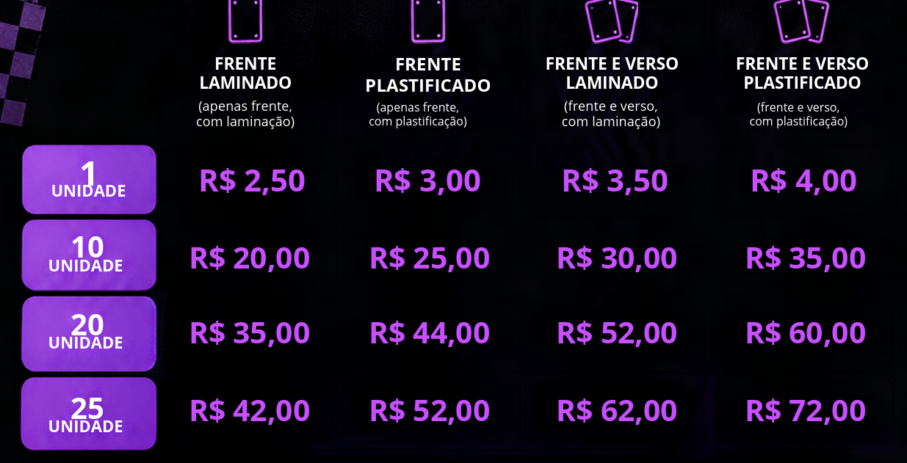

# Bottons · Edyllana

**Bottons artesanais personalizados e photocards feitos sob medida.** Catálogo online, montagem do pedido em poucos cliques e fechamento direto no WhatsApp — sem cadastro, sem servidor e sem dependências.

Site 100% estático: HTML, CSS e JavaScript puro, pronto para GitHub Pages.

---

## Destaques

- **Ideias de bottons** — carrossel com inspirações de peças que já saíram, usando as artes próprias.
- **Bottons personalizados** — modelos de 32 mm e 58 mm, 7 coberturas (Transparente, Corações, Estrelas, Estrelinhas, Flash, Holográfico e Pontinhos) e papel A4 ou fotográfico.
- **Photocards** — laminado ou plastificado, frente ou frente e verso, nas faixas de 1, 10, 20 e 25 unidades com desconto progressivo.
- **Gavetas de opções** — no desktop abrem e fecham com o mouse; no celular abrem no toque, uma por vez.
- **Favoritos** — photocards salvos com estrela, guardados no próprio navegador.
- **Carrinho persistente** — mantido ao fechar a aba, com cupons de desconto e opção de compartilhar por link.
- **Pedido pelo WhatsApp** — resumo pronto do carrinho e envio da arte como documento, preservando a qualidade da imagem.
- **Interface responsiva** — tema claro/escuro, animações de entrada e layout adaptado a celular, tablet e desktop.

## Páginas

| Arquivo | Descrição |
| --- | --- |
| `index.html` | Página inicial com hero, destaques e chamada para o pedido. |
| `catalogo.html` | Ideias de bottons, coberturas, photocards com gavetas e favoritos. |
| `pedido.html` | Montagem do pedido (bottons e photocards), carrinho, cupom e envio via WhatsApp. |

## Prévia de preços



## Estrutura

```
edyllana-bottons/
├── index.html               # página inicial
├── catalogo.html            # catálogo e favoritos
├── pedido.html              # montagem e envio do pedido
├── styles.css               # estilo compartilhado
├── script.js                # lógica, preços e configurações
├── img/                     # artes e fotos dos produtos
├── assets/                  # arquivos auxiliares
└── precos-photocards.png    # tabela de referência de preços
```

## Como executar

Abra `index.html` direto no navegador ou sirva a pasta localmente:

```bash
git clone https://github.com/josealencar1/edyllana-bottons.git
cd edyllana-bottons
python -m http.server 8000
# http://localhost:8000
```

## Publicar no GitHub Pages

1. **Settings → Pages → Deploy from branch**
2. Branch `main`, pasta `/ (root)`
3. O site é reconstruído automaticamente a cada push em `main`

## Configurações

Tudo é editado no topo do `script.js`:

- **Cupons** — objeto `COUPONS` (ex.: `DEVJOSE`, R$ 2,00 de desconto em compras acima de R$ 30,00).
- **Preços** — arrays `MODELS`, `COVERS` e `PHOTOCARDS` com valores e faixas.
- **Textos e promoções** — objeto `cfg`, com benefício de brinde ou desconto por quantidade.

## Tecnologias

HTML5 · CSS3 · JavaScript (ES6+) — sem frameworks, sem etapa de build.
